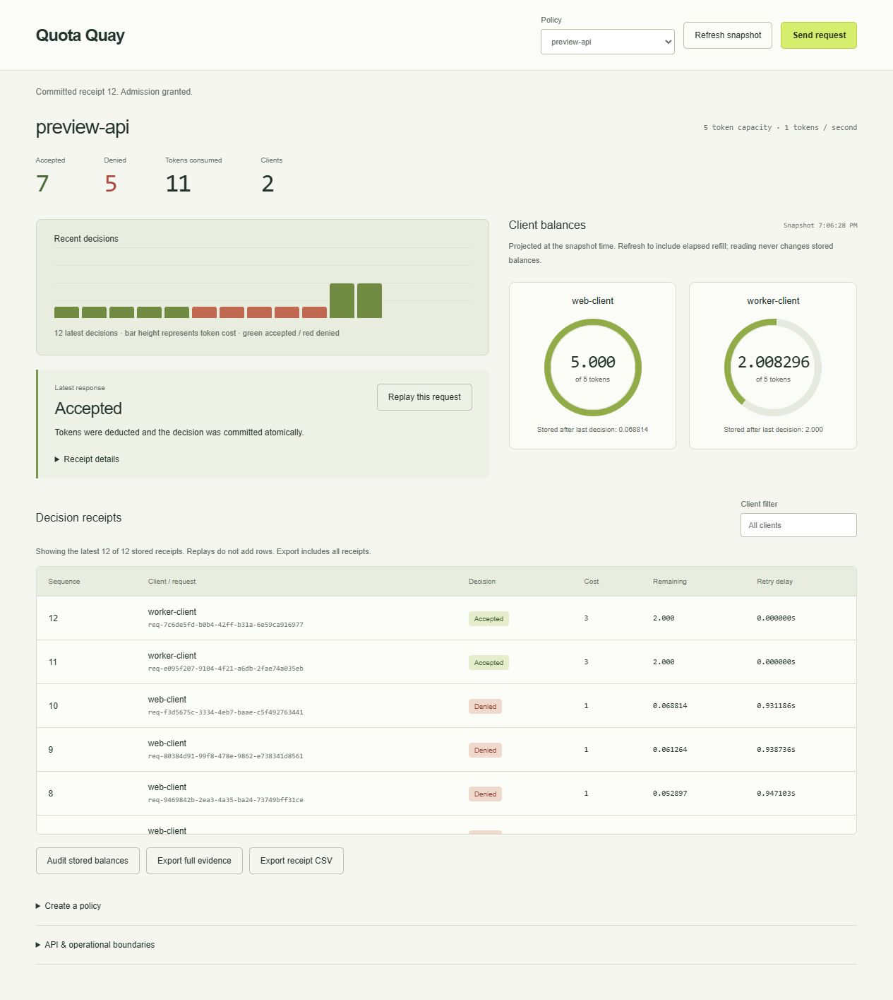

# Quota Quay

A durable token-bucket admission service with a local operations console. Send weighted requests, inspect burst behavior, replay idempotent receipts, and audit stored balances against decision history.



## Run

Python 3.10+, standard library only. No package installation or build step.

```sh
python run.py --port 8000
```

Open http://127.0.0.1:8000. A fresh checkout starts empty. Create a policy or use **Create example policy**, then send a burst. SQLite persists to `data/quota.sqlite3`; `--database` selects another path. Runtime data is ignored by Git.

## Features

- Immutable named policies with independent capacity and refill rate.
- One initially full bucket per policy/client pair; weighted integer request costs.
- Atomic admission and receipt persistence under SQLite `BEGIN IMMEDIATE`.
- Idempotent retries return the exact original decision without consuming or refilling tokens. Conflicting reuse of a request ID returns 409.
- Explicit 429 denials with integer-second `Retry-After` and exact microsecond delay in the receipt.
- A decision strip and circular snapshot gauges show request outcomes and client balances. Open **Send request** for individual requests or sequential bursts.
- Client filtering, read-only projected balances, and durable receipt history. Feedback transitions respect reduced-motion preferences.
- Replay audit checks decision arithmetic and persisted bucket state.
- Full JSON evidence and CSV receipt exports; the console shows the most recent 100 receipts.

## API

| Method | Endpoint | Purpose |
| --- | --- | --- |
| GET | `/api/policies` | List policies |
| POST | `/api/policies` | Create `{name, capacity, rate}` |
| GET | `/api/policies/{name}` | Snapshot, totals, clients, latest 100 receipts |
| POST | `/api/policies/{name}/consume` | Decide `{request_id, client, cost}` |
| GET | `/api/policies/{name}/export` | All receipts and stored/projected balances |
| GET | `/api/policies/{name}/audit` | Replay and compare stored state |

Example request bodies:

```json
{"name":"api-budget","capacity":5,"rate":1}
```

```json
{"request_id":"request-001","client":"studio-client","cost":2}
```

Creation returns 201; admission returns 200; insufficient credit returns 429; duplicate policy names or conflicting IDs return 409. Validation errors return 400. Requests require `application/json` and at most 8 KB. Client-supplied timestamps are not accepted.

An identical retry of a denied request remains denied even after the bucket has refilled. Its retry delay and balance describe the original decision, not a new attempt. Use a new request ID for a fresh decision. Retry-After is advisory: intervening requests can consume available credit.

## Arithmetic and durability

Balances are integer microtokens: one token is 1,000,000 units. A rate of R tokens/second adds R microtokens per elapsed microsecond. Refill is capped at capacity. Denied requests retain the refilled balance without deducting cost. Python integer arithmetic avoids floating-point drift.

The server reads wall-clock microseconds. Each bucket clamps time to its last effective timestamp, so a backward clock jump cannot add credit twice. A denied request's delay includes the wait to reach that effective timestamp. A forward jump may refill the bucket to capacity; this implementation does not claim immunity to wall-clock adjustments.

Bucket mutation and receipt insertion share one transaction. Concurrent connections serialize admission. A failed receipt insert rolls back the bucket change. Reads use a consistent SQLite snapshot and calculate projected refill without writing. Policies are immutable; create a new name to change the rules. The audit detects inconsistencies, not malicious rewriting of the whole database, and does not repair data.

Bounds: 100 policies; 2,000 clients and 10,000 receipts per policy; capacity/rate 1–1,000,000; cost 1–capacity. IDs use 1–64 ASCII letters, digits, dots, underscores, colons, or hyphens, starting with a letter or digit. New decisions stop at the receipt limit, while existing idempotent receipts remain replayable. There is no automatic expiration or cleanup.

## Verification

```sh
python -m unittest discover -s tests -v
npm run check
```

Node.js 22+ is needed only for JavaScript syntax checking. Fifteen Python tests cover exact refill boundaries, clock reversal, independent clients, persistence, idempotency conflicts, simultaneous requests, simultaneous retries, rollback, corruption detection, strict validation, read-only projection, and HTTP boundaries. A 1,000-decision randomized test compares balances with independent rational arithmetic. CI runs Python 3.11/3.13 on Linux and Windows.

Browser verification produced five admissions and five denials in a ten-request burst, replayed a denial without adding a row, rejected a conflicting retry, persisted history across reload, and exercised a second client, filters, new policies, audit, and downloads. An independent Fraction-based check verified all 12 receipts, both client balances, and CSV values in [example evidence](docs/example-evidence.json). Timing-dependent burst results can differ on other machines.

## Deployment boundaries

This is a loopback service and reference implementation, not a production gateway. It does not intercept external traffic and has no authentication, tenant authorization, distributed coordination, or retention service. SQLite coordinates processes sharing this database on one host; network filesystems and multi-host operation are unsupported. Stop the server before backing up the entire data directory, including any WAL files. Only explicitly allowed application assets are served; database and source files are not exposed by HTTP.

The token-bucket concept follows [RFC 3290, Appendix A](https://www.rfc-editor.org/rfc/rfc3290.html#appendix-A). This application meters abstract request tokens rather than packet bytes.
